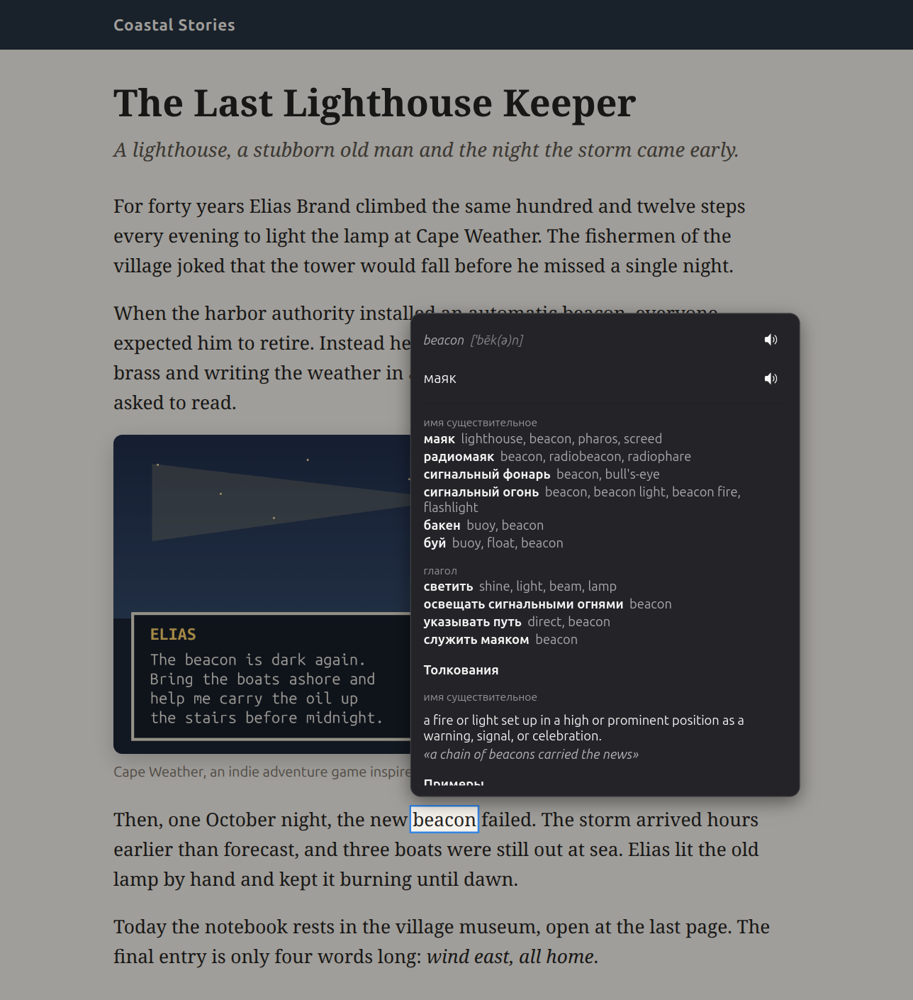
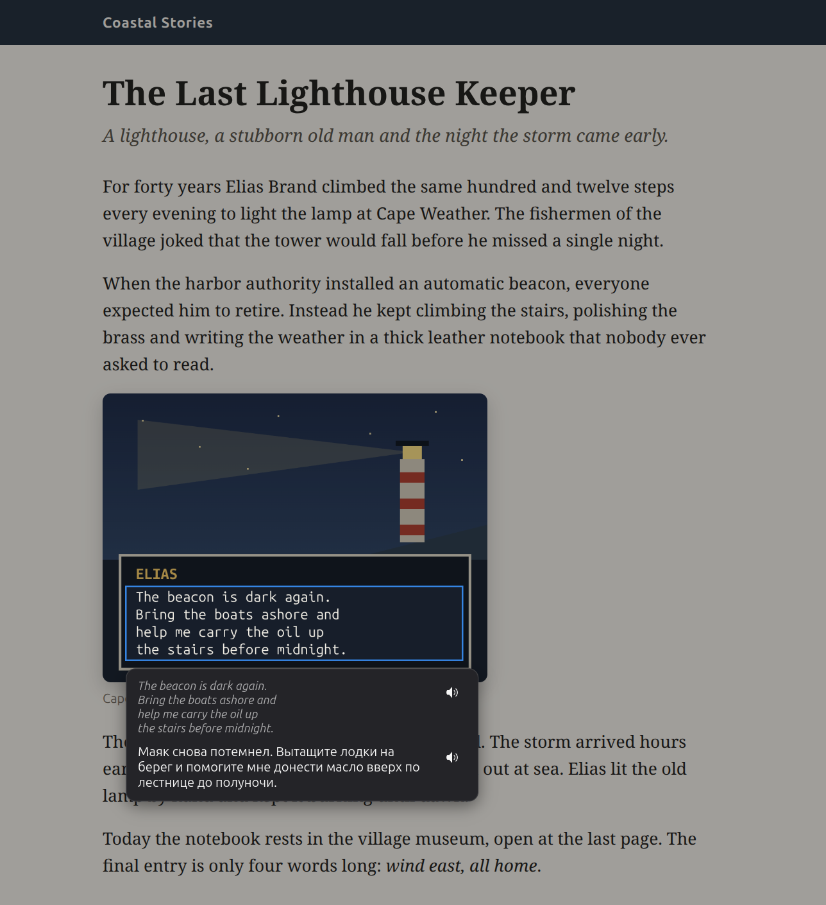
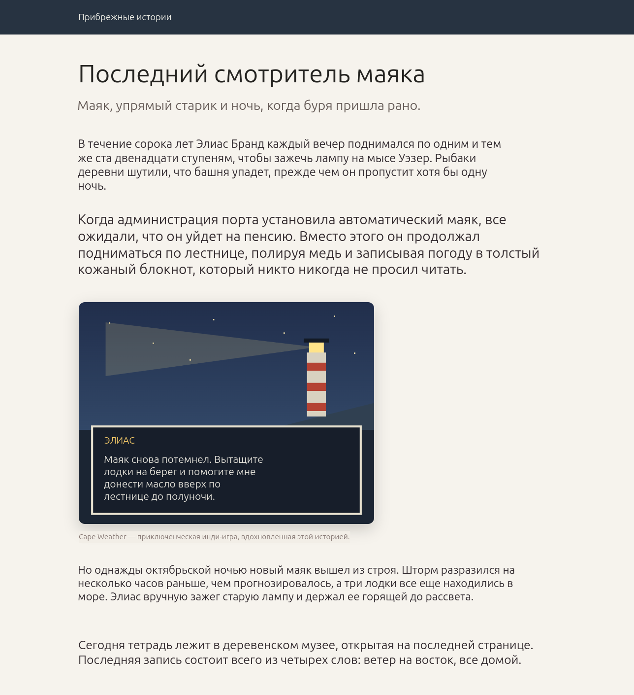

<div align="center">


# Lexpeek

Screen text translator for GNOME on Wayland

[](https://github.com/nihilmagnum/lexpeek/releases/latest)
[](LICENSE)

</div>

Select an area of the screen or text in any window, press a shortcut and get the translation with a dictionary article, or translate the whole screen at once. Lexpeek reads text from the screen itself, so it also works where text cannot be copied: in games, images and videos.

<p align="center">
  
</p>

## Features

- **Screen area translation.** Text in the selected area is recognized by Tesseract.
- **Whole screen translation.** Every paragraph on the screen is replaced with its translation, the way a browser translates a page.
- **Selected text translation.** Show the translation in a card, copy it to the clipboard or replace the selected text with it right in the input field.
- **Dictionary article** for words and short phrases: transcription, translation variants by part of speech, definitions, synonyms, examples.
- **Speech** for the original and the translation.
- **Google Translate or Yandex Translate**, chosen in the preferences.
- **Language pair with auto-detection:** text in your native language is translated into the second one, text in any other language into your native one.
- **Recognition languages:** 13 built-in ones downloadable from the app, plus any other from a `.traineddata` file.
- **Interface in English and Russian**, following the system language by default.

| Screen area | Whole screen |
|---|---|
|  |  |

## Installation

Lexpeek requires Ubuntu 26.04 or newer with GNOME on Wayland and the top bar indicator extension, which Ubuntu enables by default.

Download `lexpeek_*.deb` from the [latest release](https://github.com/nihilmagnum/lexpeek/releases/latest) and install it:

```sh
sudo apt install ./lexpeek_*.deb
```

On first launch GNOME asks you to choose the shortcuts, and Lexpeek downloads the recognition models for English and Russian, the default language pair.

## Usage

| Action | Default shortcut |
|---|---|
| Translate Screen Area | `Ctrl+Alt+R` |
| Translate Whole Screen | `Ctrl+Alt+S` |
| Translate Selected Text | `Ctrl+Alt+W` |
| Copy Translation of Selection | `Ctrl+Alt+C` |
| Replace Selection with Translation | `Ctrl+Alt+V` |

- **Screen area:** select the part with text using the mouse; Esc closes the frame.
- **Whole screen:** text already in your language stays as it is; a click or Esc closes the translation.
- **Selected text:** the card closes on Esc or when you switch to another window. Copying and replacing work without windows and report failures in a notification. Before the first replacement GNOME asks for remote desktop permission.

Preferences, shortcuts and start at login are in the top bar icon menu.

## Privacy

Only text leaves your computer: it goes to the chosen translator, and to Google Translate when you play speech. Screenshots are not kept: the file the screenshot portal creates is deleted right after reading, and the image stays in memory only while the frame is open.

Lexpeek grants itself the screenshot permission at startup, because GNOME does not show the permission dialog to background applications.

Lexpeek stores its data in:

| What | Where |
|---|---|
| Settings | `~/.config/lexpeek/settings.json` |
| Recognition models | `~/.local/share/lexpeek/tessdata` |
| Remote desktop permission | `~/.local/share/lexpeek/remote-desktop-token` |

## Known limitations

- **Translators.** Google and Yandex are used through unofficial free endpoints without a key. Their owners may restrict or close access.
- **Changing a shortcut.** It relies on an internal GNOME mechanism and may break after a GNOME update. The shortcuts themselves keep working.
- **Dictionary article.** Yandex provides no definitions or examples.
- **Whole screen translation.** It works best on plain backgrounds such as documents, websites and application windows. Text on pictures and small buttons may be missed. Yandex detects one language for the whole screen, so on a screen with several languages it translates worse than Google.

## Building from source

Building requires GNOME 48 or newer, Rust 1.88 or newer and the build packages:

```sh
sudo apt install cargo libgtk-4-dev libtesseract-dev libleptonica-dev clang libclang-dev pkg-config \
    wl-clipboard gstreamer1.0-plugins-good
git clone https://github.com/nihilmagnum/lexpeek
cd lexpeek
./install.sh
```

The script installs the binary into `~/.cargo/bin` and the desktop entry and icon into `~/.local/share`.

## Contributing

Bug reports and pull requests are welcome. [CONTRIBUTING.md](CONTRIBUTING.md) describes the project structure and how to add a translator, an interface language or an action.

## License

Lexpeek is released under the [MIT License](LICENSE).
